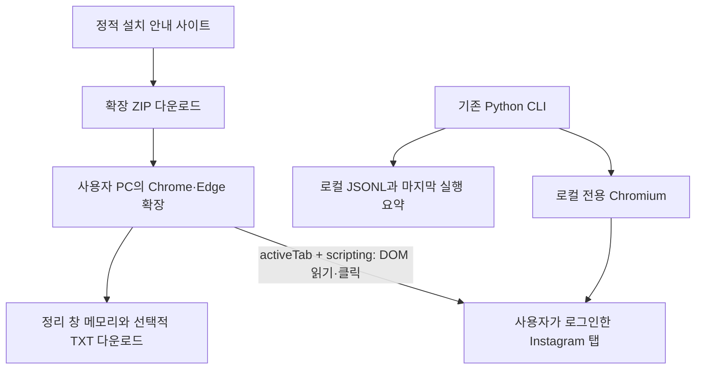

## 목차

- [구조와 실행 흐름](#구조와-실행-흐름)
- [확장 프로그램 실행 순서](#확장-프로그램-실행-순서)
- [Python 실행 순서](#python-실행-순서)
- [검증 코드의 역할](#검증-코드의-역할)
- [개발 환경](#개발-환경)
- [파일과 데이터](#파일과-데이터)
- [빌드와 공개 배포](#빌드와-공개-배포)
- [오류 처리와 제약](#오류-처리와-제약)

<br><br>

# 구조와 실행 흐름

---



계정 작업은 사용자 기기에서 실행한다. 사이트는 설치 안내와 배포 파일만 제공하며 확장과 사이트 사이의 API 연결은 없다. 사용자 로그인·세션·정리 결과를 수집하는 서버, 데이터베이스, AI 시스템은 없다. Instagram 자체 통신과 정적 호스팅의 일반 접속 로그는 별개다.

일반 웹사이트가 다른 출처인 Instagram 탭의 로그인 상태를 가져오는 방식은 사용하지 않는다. [동일 출처 정책](https://developer.mozilla.org/en-US/docs/Web/Security/Defenses/Same-origin_policy), [Chrome activeTab](https://developer.chrome.com/docs/extensions/develop/concepts/activeTab), [콘텐츠 스크립트](https://developer.chrome.com/docs/extensions/develop/concepts/content-scripts)

<br><br>

## 확장 프로그램 실행 순서

---

1. 사용자가 Instagram 탭에서 확장 아이콘을 눌러 임시 접근 권한을 부여한다. `background.js`가 해당 탭 ID를 붙여 `app.html`을 열거나 기존 정리 창을 재사용한다.
2. `app.js`는 사용자 이름 형식을 확인하고 같은 탭을 제어하는 중복 창이 없는지 확인한다. saved URL이면 이름을 자동 채우지만 대상 승인까지 자동으로 하지 않는다.
3. `InstagramRunner.collections()`가 본인 saved URL로 이동한다. `chrome.scripting.executeScript`로 격리된 환경에서 `probePage`를 실행한다. 정확한 origin·계정 경로·본인 비공개 안내를 검사한다.
4. 스크롤하며 숫자 ID·이름·URL을 모은다. 바닥에서 새 ID가 세 번 늘지 않으면 완료하며 최대 200회다. 사용자 입력은 DOM의 `textContent`로 표시한다.
5. 체크박스로 실제 컬렉션을 선택하고 전체 저장 해제 영향을 확인한다. 정확한 계정 포함 문구와 확인란이 맞아야 시작 버튼이 활성화된다. 선택·계정 변경 시 승인을 초기화한다.
6. 선택 목록을 복사해 실행한다. 현재 컬렉션의 첫 게시글을 매번 새로 읽고 해당 URL과 ID가 일치하는 게시글에서만 저장 아이콘을 클릭한다. 이미 해제된 상태는 클릭하지 않는다.
7. 알려진 전체 저장 해제 확인창이 나타나면 그 안의 단일 삭제 버튼만 누른다. 첫 실제 해제는 1초 뒤 새로고침해 최대 20초 확인한다. 후속 게시글은 추가 개별 새로고침 없이 상태 전환으로 확인한다. 게시글 사이에 1.5초 대기한다.
8. 같은 게시글이 세 번째 반복되거나 상태가 모호하면 중단한다. 빈 상태가 나오면 별도 이동으로 두 번 더 재확인한 뒤 알려진 컬렉션 삭제 메뉴와 확인창만 처리한다.
9. saved 목록을 새로 읽어 ID가 없을 때만 삭제 완료다. 한 대상에서 실패하면 뒤쪽도 멈춘다. 중단 버튼은 다음 Chrome API 동작 전부터 적용되며 이미 발생한 클릭은 되돌리지 않는다.
10. 컬렉션별 결과와 한글 이벤트를 창 메모리에 남긴다. 사용자가 요청하면 TXT를 로컬로 내려받는다. 다음 실행은 목록 조회·선택·승인을 새로 한다. 창을 닫으면 메모리는 소실된다.

권한은 `activeTab`, `scripting`뿐이다. manifest CSP의 `connect-src 'none'`과 로컬 스크립트 정책을 유지한다. 쿠키·storage·외부 네트워크 클라이언트·원격 실행 코드를 사용하지 않는다. 여러 탭에서 서로 다른 작업을 병렬 실행하는 계정 수준 잠금은 구현하지 않았으므로 한 계정은 한 창에서 실행한다.

<br><br>

## Python 실행 순서

---

현재 `instagram_cleanup.py`의 실제 순서다. 이 과정에는 AI 모델 호출이나 웹서버가 없다.

1. `sys.pycache_prefix`를 프로젝트의 `development/__pycache__`로 지정하고 모듈을 읽는다.
2. `main`이 계정·컬렉션·프로필·로그 옵션을 읽는다. 계정은 사용자 이름 형식만 허용하며 URL이나 `@`가 들어가면 인자 오류로 종료한다.
3. Playwright 설치를 확인한다. 없으면 설치 안내와 함께 종료 코드 2로 끝난다.
4. `Journal`이 실행 ID와 메모리 집계를 만들고 로그 상위 폴더를 준비한다. 전용 브라우저 프로필 폴더를 만들고 권한을 `0700`으로 지정한다.
5. 한국어 로케일의 화면 있는 Chromium을 전용 프로필로 연다. `InstagramUI`가 컬렉션 목록용 페이지와 게시글용 페이지를 따로 만든다.
6. Instagram 첫 화면을 열고 사용자가 직접 로그인한 뒤 터미널에 Enter를 입력할 때까지 기다린다. 비밀번호를 터미널이나 별도 서버로 받지 않는다. 브라우저의 로그인 상태는 사용자 기기의 전용 프로필에 남을 수 있다.
7. 본인 계정의 saved 주소를 열어 계정 경로와 한국어 비공개 안내를 확인한다. 로그인·계정 확인 경로, 인식 가능한 제한 안내가 나타나면 중단한다.
8. 컬렉션 목록을 스크롤하며 숫자 ID와 이름을 읽고 ID 기준으로 모은다. 화면 아래에서 목록이 세 번 연속 늘지 않고 로딩 표시가 없으면 끝낸다. 최대 반복은 200회다.
9. `--collection` 인자를 사용하거나 터미널에서 쉼표로 구분한 이름을 입력받는다. 이름은 정확히 일치해야 하며, 동명이면 ID를 보고 번호를 선택한다. 없는 이름이 하나라도 있으면 대상 확정을 중단한다.
10. 계정·대상 URL·다른 컬렉션의 중복 저장에도 미치는 영향을 표시한다. 계정을 포함한 최종 실행 문구가 일치하지 않으면 변경 없이 종료한다. 취소 경로에서는 요약을 새로 만들지 않는다.
11. 승인 대상을 `approved`로 기록하고 컬렉션을 입력 순서대로 처리한다. 각 대상에 `collection_started`를 기록하며 뒤쪽 대상은 처음에 미착수 상태다.
12. `next_post`가 현재 컬렉션을 새로 열어 실제로 발견한 첫 게시글 URL을 반환한다. 알려진 빈 상태의 제목과 문구가 함께 보이면 빈 컬렉션으로 판단한다. 게시글도 빈 안내도 없으면 중단한다.
13. 게시글 처리 전 `pending`을 JSONL에 쓰고 flush·fsync한다. `unsave`가 게시글을 열어 ID와 북마크 상태를 확인한다. 이미 해제된 항목은 클릭하지 않고 `already_unsaved`로 처리한다.
14. 저장된 게시글만 북마크를 클릭한다. 알려진 전체 저장 해제 확인창이 나오면 그 안의 단일 삭제 버튼을 누르고 화면의 해제 상태를 기다린다. 결과가 모호하면 북마크를 다시 누르지 않는다.
15. 실행 중 첫 실제 저장 해제만 1초 뒤 새로고침하고 최대 20초 동안 해제 상태를 확인한다. 성공하면 같은 실행의 나머지 게시글은 개별 새로고침을 생략하고 화면 상태 전환으로 완료를 판단한다.
16. 게시글 결과를 기록한 뒤 컬렉션의 현재 첫 게시글을 다시 읽는다. 같은 ID가 세 번째 발견되면 반복 정체로 중단한다. 이전 실행의 로그를 근거로 현재 저장 항목을 건너뛰지 않는다.
17. 빈 상태가 나오면 `empty_verified`·`collection_delete_pending`을 기록한다. `delete_collection`이 별도 이동으로 두 번 더 빈 상태를 확인한 뒤 옵션 메뉴와 알려진 삭제 확인창을 처리한다.
18. saved 목록을 다시 읽어 해당 컬렉션 ID가 없는지 확인한다. 확인돼야 `deleted_verified`를 기록하고 다음 컬렉션으로 넘어간다.
19. 실패 시 해당 컬렉션을 `failed`로 기록하고 전체 실행을 중단한다. 게시글 처리 중 예외는 `unknown`도 남긴다. 뒤쪽 대상은 미착수로 남는다. Ctrl+C는 중단 기록을 남기는 경로로 처리한다.
20. 브라우저를 닫고 마지막 실행의 상태·고유 게시글 수·실패 이유를 터미널과 `.summary.txt`에 표시한다. 상세 JSONL은 계속 추가된다. 기록은 복구 백업이 아니다.


<br><br>

## 검증 코드의 역할

---

`test_instagram_cleanup.py`는 실행 프로그램의 의존성이 아니라 회귀 확인용 개발 파일이었다. FakeUI·Mock으로 줄어드는 목록 전체 처리, URL·계정 경계, 미확정 결과에서 컬렉션 삭제 금지, 중복 집계 등을 실제 로그인 없이 점검했다. 기존 8개에 첫 실제 해제 새로고침 관련 3개를 더해 11개가 통과했다.

새 확장은 임시 Playwright 시나리오에서 실제 MV3 확장을 불러오고 Instagram 요청을 전부 모의 화면으로 대체해 검증했다. 실제 계정 변경은 하지 않았다. 사용자 지침에 따라 최종 검증 후 자체 테스트 소스·일회성 검증 스크립트·테스트 캐시는 최종 산출물에서 제거한다. 결과와 재현 조건은 [TESTING.md](TESTING.md)에 남긴다.

<br><br>

## 개발 환경

### 확장과 안내 사이트

---

확장은 Manifest V3, 브라우저 기본 JavaScript ES 모듈·HTML·CSS로 작성했다. 사이트도 순수 HTML·CSS·JavaScript다. npm 패키지나 프레임워크, 빌드 번들이 필요하지 않는다. 검증 환경은 Ubuntu 26.04 / Playwright 1.64.1 / Chromium 빌드 v1248이다. manifest 최소 Chrome 버전은 120이며 Edge 실기기 검증은 미실시다.

개발 미리보기는 `python3 development/build_release.py` 후 `python3 -m http.server 8765 --bind 127.0.0.1 --directory development/.hosting/dist`로 실행한다. 확장은 브라우저 확장 관리 화면에서 최상위 확장 폴더를 직접 불러온다. 사이트 배포 도구에 필요한 Node는 로컬 `development/.tools/`에 두며 공개 확장이나 정적 사이트 런타임에 포함하지 않는다. 이번 배포 도구 실행 환경은 Node v26.13.0이다.

<br><br>

### 기존 Python 환경

---

요구 환경은 Python 3.10 이상, 화면이 있는 Linux/WSLg, 한국어 Instagram UI다. 선언 의존성은 `development/requirements.txt`의 `playwright>=1.49,<2`이며 정확한 버전은 고정되어 있지 않다. 설치된 패키지를 2026-10-31에 재확인했다. 아래는 관측 버전이며 최신 안정 버전이나 다른 환경과의 호환성을 보장하는 목록이 아니다.

| 항목 | 현재 환경 |
| --- | --- |
| OS·화면 | Ubuntu 26.04 amd64 / WSLg |
| Python | 3.14.4 |
| Playwright | 1.64.1 |
| pyee / greenlet | 14.0.0 / 3.5.6 |
| typing_extensions | 4.16.0 |
| Chromium | Playwright 빌드 v1248 |

일반 설치·실행은 [README.md](README.md)를 따른다. 최초에는 `python3 -m venv .venv`가 `ensurepip is not available`로 실패하여 프로젝트 가상환경에 PyPA pip 부트스트랩을 적용했다. 현재 위치인 `development/.venv`에 처음 준비할 때의 설치 대안은 다음과 같다.

```bash
python3 -m venv --without-pip development/.venv
python3 - <<'PY'
from pathlib import Path
from urllib.request import urlopen
with urlopen('https://bootstrap.pypa.io/get-pip.py', timeout=30) as response:
    Path('development/.venv/get-pip.py').write_bytes(response.read())
PY
development/.venv/bin/python development/.venv/get-pip.py
development/.venv/bin/python -m pip install -r development/requirements.txt
development/.venv/bin/python -m playwright install chromium
```

브라우저 최초 실행은 `libnspr4.so` 누락으로 종료됐다. `ldd`로 `libnspr4`·`libnss3`·`libasound2t64`의 공유 라이브러리 누락을 확인했다. `sudo -n true`도 인증 필요로 실패하여 시스템 설치 대신 다음과 같이 Ubuntu 패키지를 프로젝트 내부에 추출했다.

```bash
mkdir -p development/.venv/browser-deps
cd development/.venv/browser-deps
apt-get download libnspr4 libnss3 libasound2t64
for package in ./*.deb; do dpkg-deb -x "$package" root; done
cd ../../..
LD_LIBRARY_PATH="$PWD/development/.venv/browser-deps/root/usr/lib/x86_64-linux-gnu${LD_LIBRARY_PATH:+:$LD_LIBRARY_PATH}" \
  development/.venv/bin/python instagram_cleanup.py --account example_user
```

이 대안은 현재 Ubuntu 26.04 amd64 패키지 기준이며 다른 배포판에서 그대로 재사용하지 않는다. 명령별 라이브러리 경로만 지정하므로 전역 환경변수나 시스템 패키지 상태를 바꾸지 않는다. `development/.venv`를 다시 만들면 이 라이브러리도 다시 준비해야 한다.

설치 위치는 프로젝트 `development/.venv`와 사용자 브라우저 캐시 `~/.cache/ms-playwright`다. 시스템·전역 설정은 변경하지 않았다. Python CLI는 HTTP 서버나 접속 포트를 사용하지 않는다. 안내 사이트의 개발 미리보기 서버와는 별개다.

가상환경 이동 후 `python3 -m venv --without-pip development/.venv`로 실행 환경 설정을 갱신하고 pip·Playwright 진입 스크립트의 이전 절대 경로를 보정했다. 현재 환경에서 pip·Playwright·대표 코드 실행을 확인했다. 대표 코드는 `sys.pycache_prefix`를 프로젝트의 `development/__pycache__`로 지정한다. 다른 코드에서 이 모듈을 import하는 개발 작업에서도 캐시를 내부에 두려면 Python 시작 시 `PYTHONPYCACHEPREFIX`를 같은 경로로 지정한다.

프로젝트 내부 의존성을 다시 준비하려면 위 추출 절차를 재실행한다. 제거할 때는 해당 프로젝트의 `development/.venv/browser-deps`만 정리한다. 사용자 Chromium 캐시는 다른 Playwright 프로젝트와 공유할 수 있으므로 프로젝트 전용 파일로 취급하지 않는다.

브라우저에서 한글이 보이지 않는 문제는 `fc-list :lang=ko` 결과가 비어 있어 한글 글꼴 누락으로 확인했다. Ubuntu `fonts-noto-cjk` 패키지의 Regular·Bold 글꼴을 사용자 범위에 설치했다. 재설치 절차는 다음과 같다.

```bash
mkdir -p development/.venv/font-package
cd development/.venv/font-package
apt-get download fonts-noto-cjk
for package in ./*.deb; do dpkg-deb -x "$package" root; done
mkdir -p "$HOME/.local/share/fonts/savedpoststree-noto-cjk"
install -m 644 root/usr/share/fonts/opentype/noto/NotoSansCJK-Regular.ttc \
  root/usr/share/fonts/opentype/noto/NotoSansCJK-Bold.ttc \
  "$HOME/.local/share/fonts/savedpoststree-noto-cjk/"
fc-cache -f "$HOME/.local/share/fonts/savedpoststree-noto-cjk"
cd ../../..
```

글꼴은 같은 Linux 사용자의 다른 앱에서도 사용할 수 있다. 설치 후 Chromium을 재시작한다. 되돌리려면 이번에 만든 `~/.local/share/fonts/savedpoststree-noto-cjk` 폴더만 제거하고 `fc-cache -f`를 실행한다. 시스템 글꼴이나 기존 사용자 글꼴은 변경하지 않았다.


<br><br>

## 파일과 데이터

---

| 파일·구성요소 | 역할 |
| --- | --- |
| `insta-saved-collection-clean-extension/background.js` | 아이콘 클릭과 정리 창 재사용 |
| `app.html`, `app.css`, `app.js` | 입력·선택·승인·중단·TXT 내려받기 |
| `runner.js`의 `probePage` | Instagram DOM 판독·경계 검사·제한된 클릭 |
| `runner.js`의 `InstagramRunner` | Chrome API 이동·대기·반복·결과 집계 |
| `instagram_cleanup.py`의 `main` | 인자·직접 로그인·승인·종료 |
| `InstagramUI` / `clean_collection` | 두 페이지 UI 제어 / 정리 루프 |
| `Journal` | JSONL append·fsync와 실행 요약 |
| `Collection`, `post_id`, `collection_from_link` | 컬렉션 정보와 URL 경계 검사 |
| `development/site/` | 공개 안내 사이트 원본 |
| `development/build_release.py` | 허용한 확장 파일·LICENSE ZIP 및 정적 배포 폴더 생성 |
| `development/requirements.txt` | Python 직접 의존성 |
| `development/support/` | 공개 제외한 사용자 기록·진단·설계 자료 |

확장 이벤트는 `time`, `account`, `event`, `message`와 필요시 `collection`, `collection_id`, `url`, `post_id`, `reason`을 메모리에 둔다. `pending`은 클릭 전, `unknown`은 미확정 결과, `deleted_verified`는 ID 부재 확인까지 완료했다는 뜻이다. 고유 게시글 수는 실행 내 shortcode로 중복 제거하고 `unsaved`를 우선 보존한다.

Python 기본 JSONL 경로는 스크립트가 있는 프로젝트 기준이다. 사용자 지정 상대 `--log`는 실행 폴더 기준이다. 기존 행은 재작성하지 않으며 구버전에는 한글 `message`가 없을 수 있다. `.summary.txt`는 마지막 실행으로 덮어쓰고 JSONL은 누적한다. 로그를 이용한 자동 상태 복원·자동 건너뛰기는 없다. 로그와 인증 프로필은 Git에서 제외한다.

<br><br>

## 빌드와 공개 배포

---

```bash
python3 development/build_release.py
```

확장 버전은 `insta-saved-collection-clean-extension/manifest.json`에서 읽는다. 출력은 `development/.hosting/dist/`의 정적 사이트와 `downloads/insta-saved-collection-clean-extension-0.1.1.zip`, 대응 `.sha256`이다. ZIP의 시간과 파일 순서를 고정해 동일 소스의 해시를 재현한다. 사이트 다운로드 링크는 현재 버전으로 명시돼 있으므로 버전을 바꾸면 두 HTML 링크도 함께 갱신한다.

공개 소스는 `https://github.com/ind2x/savedpoststree`, 라이선스는 MIT다. v0.1.1은 새 서비스명과 설치 폴더·다운로드 파일명이 반영된 베타다. 원격 저장소 이름은 사용자가 별도로 변경하므로 저장소 URL은 유지한다. 사이트도 기존 project ID와 공개 URL·canonical 주소를 유지하며 표시명과 배포 파일을 갱신한다. 인증·환경·실제 계정 로그는 공개하지 않는다. 배포 전에 `git diff --cached --name-only`와 ZIP 목록을 확인한다.

2026-11-01에 로컬 원본 폴더를 `insta-saved-collection-clean`으로 바꾸고 `.git` 이력을 그대로 유지했다. 사용자 표시명은 `InstaSavedCollectionClean`, 설치 폴더·배포 파일명은 `insta-saved-collection-clean-extension`을 사용한다. 기존 단일 실행 코드 `instagram_cleanup.py`는 유지한다. 가상환경 진입 스크립트·활성화 스크립트·설정의 프로젝트 절대 경로를 새 위치에 맞춘다. 과거 실행 로그·요약·문서 보관본은 당시 기록 그대로 보존하므로 이전 이름이나 경로를 포함할 수 있다.

Python의 새 기본 프로필은 `~/.local/share/insta-saved-collection-clean/chromium`이다. 기존 `~/.local/share/savedpoststree/chromium`은 이동·삭제하지 않았으며 `--profile`로 재사용할 수 있다. 사용자 범위의 기존 한글 글꼴 폴더도 실제 설치 위치를 유지한다. 기존 확장 설치는 폴더 이동 후 새 경로에서 다시 불러와야 한다.

사이트는 Sites 정적 호스팅을 사용한다. 서비스별 식별자가 있는 `.openai/hosting.json`과 배포용 별도 Git 메타데이터는 무시된 `development/.hosting/`에 두고, 원본 사이트는 `development/site/`에서 관리한다. 배포 시 이 폴더의 기존 project ID를 재사용해 소스를 동기화·커밋·패키징하고 저장된 버전만 공개 배포한다. 소스 접근 자격 증명은 세션 메모리와 도구 stdin으로만 전달하며 파일·명령 인자·문서에 남기지 않는다. 공개 URL은 [README.md](README.md)를 따른다.

<br><br>

## 오류 처리와 제약

---

한국어 문구와 역할 선택자에 의존한다. DOM이나 확인창이 달라지면 성공을 추정하지 않고 중단한다. 기본 UI 대기는 20초, 목록 스크롤은 최대 200회다. 일반 오류 화면만으로 봇 감지·IP 제한 여부를 판정하지 않는다. 자동 롤백·dry-run·모바일 앱 지원·스토어 등록은 구현하지 않았다.

Python 종료 코드는 정상·확인 문구 취소 `0`, 일반 오류 `1`, 인자·의존성 오류 `2`, Ctrl+C `130`이다. 최종 확인 취소는 요약을 갱신하지 않고, 승인 전 일반 오류는 대상 없는 요약을 남길 수 있다. 마지막 요약만으로 전체 이력을 판단하지 않는다.

오류 후에는 실제 Instagram 화면과 내려받은 기록 또는 로컬 JSONL을 대조하고 현재 목록의 남은 대상만 다시 선택한다. 기존 Python 실제 계정 결과와 새 확장의 모의 검증 범위는 [TESTING.md](TESTING.md)에서 구분한다. 확장의 실제 Instagram UI와 Windows Chrome·Edge에서의 최종 사용성은 후속 사용자 확인 항목이다.
