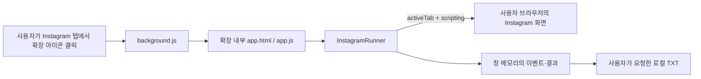

## 목차

- [구조와 범위](#구조와-범위)
- [실행 흐름](#실행-흐름)
- [파일과 데이터](#파일과-데이터)
- [개발과 패키징](#개발과-패키징)
- [오류와 제약](#오류와-제약)
- [제거한 구성과 보존 자료](#제거한-구성과-보존-자료)

<br><br>

# 구조와 범위

---



사이트·로컬 HTTP 서버·백엔드·Python CLI는 없다. 확장은 브라우저 기본 JavaScript ES 모듈·HTML·CSS와 Chrome API만 사용한다. Instagram 외의 서비스에 의존하는 실행 경로, AI 호출, 데이터베이스, npm 패키지나 번들 빌드가 없다. ZIP 생성 도구만 Python 3 표준 라이브러리를 사용하며 확장 런타임과 분리된다.

<br><br>

## 실행 흐름

---

1. 사용자가 Instagram 탭에서 확장 아이콘을 눌러 임시 접근 권한을 부여한다. `background.js`가 탭 ID를 붙여 정리 창을 열거나 기존 창을 재사용한다.
2. `app.js`가 사용자 이름 형식과 같은 탭의 중복 정리 창을 확인한다. saved URL이면 이름을 채우지만 대상까지 승인하지 않는다.
3. `InstagramRunner.collections()`가 본인 saved URL을 열고 `chrome.scripting.executeScript`로 `probePage`를 실행한다. 정확한 origin·계정 경로·본인 비공개 안내를 확인한다.
4. 스크롤하며 숫자 ID·이름·URL을 모은다. 바닥에서 새 ID가 세 번 늘지 않으면 완료하며 최대 200회다. 사용자 입력은 `textContent`로 표시한다.
5. 실제 목록의 대상 선택·중복 저장 영향 확인·정확한 계정 포함 문구가 맞아야 시작 버튼을 활성화한다. 계정과 선택 변경 시 승인을 초기화한다.
6. 현재 컬렉션을 매번 새로 열어 첫 게시글을 처리한다. URL·게시글 ID가 일치하는 저장된 북마크만 클릭하며 이미 해제된 상태는 건너뛴다.
7. 알려진 전체 저장 해제 확인창의 단일 삭제 버튼만 처리한다. 첫 실제 해제는 1초 후 새로고침해 최대 20초 확인한다. 이후 개별 새로고침은 생략하고 화면 상태를 확인한다. 게시글 사이에는 1.5초 대기한다.
8. 같은 게시글이 세 번째 반복되거나 상태가 모호하면 중단한다. 빈 상태가 나오면 별도 이동으로 두 번 더 확인하고 알려진 컬렉션 삭제 메뉴와 확인창만 처리한다.
9. saved 목록을 새로 읽어 대상 ID가 없을 때만 삭제 완료다. 한 대상 실패 시 뒤쪽도 멈춘다. 중단은 다음 Chrome API 동작 전부터 적용되며 이미 발생한 클릭은 되돌리지 않는다.
10. 컬렉션별 결과와 한글 이벤트는 창 메모리에 남긴다. 사용자가 요청하면 TXT로 내려받고, 다음 실행은 목록 조회·선택·승인을 새로 한다. 창 종료 시 메모리는 소실된다.

<br><br>

## 파일과 데이터

---

| 구성요소 | 역할 |
| --- | --- |
| `manifest.json` | MV3·버전·권한·아이콘·CSP |
| `background.js` | 아이콘 클릭과 정리 창 재사용 |
| `app.html`, `app.css`, `app.js` | 입력·선택·승인·중단·TXT 내려받기 |
| `runner.js`의 `probePage` | DOM 판독·URL 경계·제한된 클릭 |
| `runner.js`의 `InstagramRunner` | 탭 이동·대기·반복·오류 중단·집계 |
| `icons/` | 로컬 아이콘과 벡터 원본 |
| `development/build_release.py` | 확장 ZIP과 SHA-256 생성 |
| `development/releases/` | 무시된 로컬 배포 생성물 |
| `development/support/` | 공개 제외한 기존 실제 실행 기록·진단 자료 |

이벤트는 `time`, `account`, `event`, `message`와 필요시 `collection`, `collection_id`, `url`, `post_id`, `reason`을 담는다. `pending`은 클릭 전, `unknown`은 미확정, `deleted_verified`는 ID 부재까지 확인한 상태다. 고유 게시글 수는 실행 내 shortcode로 중복 제거하고 `unsaved`를 우선한다. 기록은 복구 백업이나 다음 실행의 상태 복원 자료가 아니다.

권한은 `activeTab`, `scripting`뿐이다. CSP의 `connect-src 'none'`과 로컬 스크립트 정책을 유지한다. 쿠키·브라우저 storage·원격 코드·외부 API 클라이언트가 없다. Instagram 자체 통신과 GitHub 배포 다운로드는 별개다.

<br><br>

## 개발과 패키징

---

개발자 모드에서 확장 폴더를 직접 불러오면 된다. npm 설치·Python 가상환경·웹서버가 필요하지 않다. 코드 수정 후 브라우저 확장 관리 화면에서 새로고침하고 정리 창도 다시 연다. manifest 최소 Chrome 버전은 120이다.

```bash
python3 development/build_release.py
```

버전은 manifest에서 읽고 `development/releases/insta-saved-collection-clean-extension-0.1.2.zip`과 `.sha256`을 만든다. 파일 순서와 ZIP 시간을 고정해 같은 소스의 해시를 재현한다. ZIP 안에는 `insta-saved-collection-clean-extension/`과 LICENSE만 넣으며 로그·인증·도구·문서는 포함하지 않는다. 스토어 제출 전용 ZIP이나 스토어 자동 배포는 구현하지 않았다.

현재 배포 채널은 GitHub `ind2x/savedpoststree`의 Release다. 저장소 이름은 사용자가 별도로 변경한다. 배포 전 ZIP 목록·manifest·원본 일치·개인 자료 제외와 Git 변경 목록을 확인한다. 필요한 검증은 일회성 외부 환경에서 수행하고 최종 프로젝트에는 테스트 소스·검증용 가상환경·Node 도구를 남기지 않는다.

<br><br>

## 오류와 제약

---

한국어 문구·역할 선택자에 의존하며 UI 변경 시 중단한다. 기본 대기는 20초다. 일반 오류 화면만으로 봇 감지·IP 제한 여부를 판정하지 않는다. 모호한 결과에서 다시 토글하지 않고 실제 Instagram 상태와 내려받은 기록을 대조한다.

계정 단위의 여러 탭 병렬 실행 잠금은 없으므로 한 계정은 한 창에서 작업한다. 자동 롤백·dry-run·모바일 앱·공식 API·스토어 등록은 미구현이다. 실제 Instagram 계정의 확장 삭제 동작과 Windows Chrome·Edge 실기기 사용성은 후속 사용자 확인 항목이다.

<br><br>

## 제거한 구성과 보존 자료

---

v0.1.2에서 안내 사이트·호스팅 체크아웃·배포 아카이브·사이트 시안, 기존 `instagram_cleanup.py`, Playwright 의존성 목록·가상환경·프로젝트 Node 도구·캐시를 제거했다. 확장 JS·HTML·CSS와 정리 로직은 그대로다. 이전 코드는 Git 이력에 있으며 현재 실행 경로로 안내하지 않는다.

기존 배포 사이트는 공개 접근을 제거하고 소유자만 허용했다. 연결된 Sites 도구에는 영구 삭제 기능이 없어 원격 프로젝트·배포 이력의 완전 삭제는 미실시다. 관리 화면에서의 완전 삭제에 필요한 식별자와 상태는 무시된 로컬 기록에 보존했다. 이것은 확장의 실행 의존성이 아니다.

실제 계정 로그·개인 진단 화면·로그인 프로필은 테스트 산출물로 취급하지 않았다. 프로젝트 내부의 개인 자료는 `development/support/`에, 기존 로그인 프로필과 사용자 범위 글꼴은 기존 사용자 홈에 보존한다. 과거 원문은 당시 이름·경로를 포함할 수 있으며 Git과 ZIP에서 제외한다.
