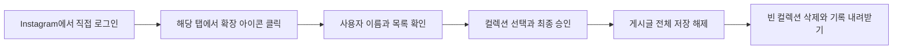

## 목차

- [InstaSavedCollectionClean](#instasavedcollectionclean)
- [설치](#설치)
- [사용 방법](#사용-방법)
- [개인정보와 권한](#개인정보와-권한)
- [중단과 문제 해결](#중단과-문제-해결)
- [파일 구성과 개발 문서](#파일-구성과-개발-문서)

<br><br>

# InstaSavedCollectionClean

---

PC Chrome·Edge에서 Instagram에 저장한 게시물을 컬렉션 단위로 정리하는 **독립 실행 확장 프로그램**입니다. 선택한 컬렉션의 게시글을 전체 저장 해제하고, 빈 상태를 재확인한 컬렉션을 삭제합니다. 안내 사이트·웹서버·Python 설치 없이 브라우저에서 실행합니다. AI API나 토큰을 사용하지 않습니다.

[설치 ZIP 내려받기](https://github.com/ind2x/savedpoststree/releases/download/v0.1.3/insta-saved-collection-clean-extension-0.1.3.zip) · [최신 Release](https://github.com/ind2x/savedpoststree/releases/tag/v0.1.3) · [문의](https://github.com/ind2x/savedpoststree/issues)

**전체 저장 해제는 다른 컬렉션에 중복 저장한 같은 게시글에도 영향을 줍니다.** 원본 작성자의 게시물이나 좋아요는 변경하지 않습니다. 기록은 원상 복구 백업이 아닙니다.

현재 배포본은 **v0.1.3 베타**이며 Chrome·Edge의 개발자 모드로 직접 설치하는 브라우저 확장 프로그램입니다. Chrome 웹 스토어·Edge 추가 기능 스토어에는 아직 등록하지 않았습니다. 한국어 Instagram 웹 화면을 대상으로 하며 휴대폰 Instagram 앱은 지원하지 않습니다.

승인·중단·목록 표시 회귀 검사 12개를 통과했습니다. 모의 API를 연결한 Windows Chrome 미리보기에서 화면과 선택 동작도 확인했지만, 실제 Instagram 계정의 저장 해제·컬렉션 삭제와 Chrome·Edge 실사용 전체를 검증한 것은 아닙니다.

<br><br>

## 설치

---

1. 위 **설치 ZIP 내려받기**를 누르거나 Release의 **Assets**에서 `insta-saved-collection-clean-extension-0.1.3.zip`을 받습니다. 자동 제공되는 `Source code`는 전체 개발 소스이므로 설치용 ZIP과 구분합니다. 받은 ZIP의 압축을 풉니다.
2. Chrome은 주소창에 `chrome://extensions`, Edge는 `edge://extensions`를 입력합니다.
3. **개발자 모드**를 켜고 **압축해제된 확장 프로그램을 로드합니다**를 누릅니다.
4. 압축을 푼 폴더 안에서 `manifest.json`이 있는 `insta-saved-collection-clean-extension` 폴더를 선택합니다. ZIP 자체를 선택하지 않습니다.
5. `https://www.instagram.com/`에서 직접 로그인하고 표시 언어를 한국어로 설정합니다.

Chrome·Edge 120 이상을 기준으로 작성했습니다. 소스를 받은 경우 최상위의 확장 폴더를 바로 불러올 수 있습니다. 이전 설치본은 사용 중지하고 새 폴더를 불러와 중복 실행을 피하세요. 확장 폴더를 옮기거나 지우면 다시 불러와야 합니다.

<br><br>

## 사용 방법

---



1. 로그인한 Instagram 탭에서 확장 아이콘을 누릅니다. 별도의 정리 창이 열립니다.
2. URL이나 `@` 없이 본인 사용자 이름을 입력하고 **컬렉션 불러오기**를 누릅니다. 목록 조회만으로 저장 상태를 변경하지 않습니다.
3. 정리할 컬렉션을 선택하고 오른쪽 대상 목록을 확인합니다. 이름이 같으면 ID도 표시됩니다.
4. 중복 저장 영향 확인란을 선택하고 화면의 문구를 그대로 입력합니다. 예: `example_user 저장 해제 및 컬렉션 삭제`.
5. 실행 버튼을 누르면 계정과 대상 선택이 즉시 잠기며, 준비가 끝난 뒤에도 승인 상태가 같은지 확인합니다. Instagram 탭과 정리 창을 모두 열어둡니다. 첫 실제 저장 해제만 새로고침으로 확인하고, 이후에는 화면 상태 전환으로 확인합니다. 컬렉션 목록은 매번 새로 읽습니다.
6. 완료 후 **기록 내려받기**로 컬렉션별 결과를 TXT로 저장하고 Instagram에서 결과를 확인합니다. 화면의 ‘미조회’는 현재 목록을 다시 읽지 않았다는 뜻이며, **컬렉션 불러오기**로 남은 목록을 확인할 수 있습니다.

<br><br>

## 개인정보와 권한

---

확장 권한은 `activeTab`, `scripting` 두 가지입니다. 사용자가 아이콘을 눌러 허용한 Instagram 탭의 화면을 읽고 클릭합니다. 비밀번호·쿠키·로그인 토큰을 읽거나 서비스 서버로 전송하지 않습니다. 로그인은 Instagram 자체에서 처리하고 기존 브라우저가 로그인 상태를 관리합니다.

- 사용자 이름·컬렉션 이름·작업 결과는 열린 정리 창의 메모리에만 있습니다.
- 기록을 내려받는 경우에만 사용자 기기에 TXT 파일을 만듭니다. 창을 닫으면 내려받지 않은 기록은 사라집니다.
- 쿠키·브라우저 저장소·상시 사이트 접근 권한, 분석 도구, 원격 코드와 외부 API 클라이언트를 넣지 않았습니다.
- 이동과 클릭으로 Instagram 자체의 통신은 발생합니다. 우리 서버를 경유하지 않습니다. GitHub에서 파일을 받을 때의 일반 접속 정보는 GitHub 정책에 따릅니다.
- 내려받은 기록에는 계정·컬렉션·게시글 정보가 포함될 수 있으므로 공개 게시하지 마세요.

<br><br>

## 중단과 문제 해결

---

**중단** 버튼은 실행 준비 중에도 적용되며, 중단을 확인한 뒤 새 이동·클릭 요청을 시작하지 않습니다. 이미 브라우저에 전달한 동작은 완료될 수 있고 되돌리지는 않습니다. 한 컬렉션에서 오류가 나면 뒤쪽 대상도 중단합니다. 재시작할 때는 현재 목록을 다시 불러오고 남은 대상만 새로 승인합니다. 한 계정은 한 창에서 작업하세요.

| 상황 | 확인 방법 |
| --- | --- |
| 접근 권한이 없다고 표시됨 | Instagram 탭으로 돌아가 확장 아이콘을 다시 누릅니다. 다른 출처로 이동하면 임시 권한이 끝날 수 있습니다. |
| 목록을 확인하지 못함 | 로그인 계정·사용자 이름·한국어 설정과 본인 saved 화면을 확인합니다. |
| ‘문제가 발생했습니다’ 또는 제한 안내 | Instagram 화면을 직접 확인하고 정상화될 때까지 실행을 멈춥니다. 이 문구만으로 봇 감지나 IP 제한이라고 판정하지 않습니다. |
| 창을 닫아 기록이 없음 | 내려받지 않은 메모리 기록은 복구하지 않습니다. 실제 Instagram 상태를 확인합니다. |
| 과거 컬렉션이 목록에 없음 | 프로그램이 삭제한 것으로 추정하지 않고 현재 계정 상태를 직접 확인합니다. |

모호한 UI에서는 재클릭하지 않고 중단합니다. 제한 우회·자동 롤백·AI 분류·공식 Instagram API 연동은 구현하지 않았습니다.

<br><br>

## 파일 구성과 개발 문서

---

```text
insta-saved-collection-clean/
├── insta-saved-collection-clean-extension/   # 브라우저에서 불러올 제품 전체
│   ├── manifest.json
│   ├── app.html / app.js / app.css
│   ├── runner.js / background.js
│   └── icons/
├── README.md / AGENTS.md / DEVELOPMENT.md / TESTING.md
├── LICENSE
├── development/
│   ├── build_release.py                    # 표준 Python만 쓰는 ZIP 생성 도구
│   ├── releases/                           # 로컬 생성, Git 제외
│   └── support/                            # 비공개 로컬 자료, Git 제외
│       ├── diagnostics/fix-v0.1.3/          # 최신 수정 전·후 검증 출력
│       └── archive/                       # 과거 CLI·사이트·문서 기록
└── .gitignore
```

GitHub의 현재 소스와 Release는 최신 v0.1.3 기준으로 관리합니다. 과거 배포 ZIP·태그는 정리하며, 개인 기록과 검증 원본은 GitHub와 설치 ZIP에 넣지 않습니다.

사용자에게 필요한 것은 확장 폴더와 브라우저뿐입니다. Python은 개발자가 배포 ZIP을 만들 때만 선택적으로 사용하며 제품 실행에 필요하지 않습니다. 기존 Python CLI와 웹사이트·호스팅·프로젝트 가상환경은 제거했습니다.

[DEVELOPMENT.md](DEVELOPMENT.md): 동작·구조·패키징 · [TESTING.md](TESTING.md): 검증 범위와 결과 · [AGENTS.md](AGENTS.md): 개발 규칙 · [LICENSE](LICENSE): MIT 라이선스

Instagram의 공식 제품이나 제휴 제품이 아닙니다.
