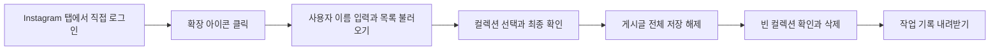

## 목차

- [savedpoststree](#savedpoststree)
- [확장 프로그램 설치](#확장-프로그램-설치)
- [컬렉션 정리](#컬렉션-정리)
- [개인정보와 기록](#개인정보와-기록)
- [문제 해결](#문제-해결)
- [Python 도구 사용](#python-도구-사용)
- [프로젝트 구조](#프로젝트-구조)
- [개발 문서와 라이선스](#개발-문서와-라이선스)

<br><br>

# savedpoststree

---

Instagram에 저장한 게시물을 선택한 컬렉션 단위로 정리합니다. PC Chrome·Edge 확장 프로그램이 내 브라우저에서 게시글을 **전체 저장 해제**하고, 비어 있는지 재확인한 컬렉션을 삭제합니다. 반복 작업은 일반 프로그램 코드로 실행되며 AI API나 토큰을 사용하지 않습니다.

[설치 안내 사이트](https://savedpoststree.nsxz1359.chatgpt.site/) · [v0.1.0 베타 다운로드](https://github.com/ind2x/savedpoststree/releases/tag/v0.1.0)

**전체 저장 해제는 다른 컬렉션에 중복 저장한 같은 게시글에도 영향을 줍니다.** 기록은 복구 백업이 아닙니다. 원본 작성자의 게시물과 좋아요는 변경하지 않습니다.

현재 확장 프로그램은 모의 Instagram 화면에서 검증한 베타입니다. 실제 Instagram 계정에서 이 확장의 삭제 동작을 검증하지는 않았습니다. 기존 Python 도구의 실제 계정 실행 기록과 구분합니다. PC의 한국어 Instagram 웹 화면을 대상으로 하며 휴대폰 Instagram 앱과 스토어 설치는 지원하지 않습니다.

<br><br>

## 확장 프로그램 설치

---

1. 위 다운로드 페이지에서 `savedpoststree-extension-0.1.0.zip`을 받고 압축을 풉니다.
2. Chrome은 주소창에 `chrome://extensions`, Edge는 `edge://extensions`를 입력합니다.
3. **개발자 모드**를 켜고 **압축해제된 확장 프로그램을 로드합니다**를 누릅니다.
4. 압축을 푼 폴더 안에서 `manifest.json`이 들어 있는 `savedpoststree-extension` 폴더를 선택합니다. ZIP 파일 자체를 선택하지 않습니다.
5. Instagram 웹사이트 `https://www.instagram.com/`에서 직접 로그인하고 표시 언어를 한국어로 설정합니다.

Chrome·Edge 120 이상을 기준으로 작성했습니다. 실제 자동 검증 환경은 Chromium이며 Windows Chrome·Edge에서의 최종 사용성은 별도 확인이 필요합니다. 확장 폴더를 옮기거나 지우면 브라우저에서 다시 불러와야 합니다.

<br><br>

## 컬렉션 정리

---



1. 로그인한 **Instagram 탭에서** 확장 아이콘을 누릅니다. 별도의 정리 창이 열립니다.
2. URL이나 `@` 없이 본인 사용자 이름을 입력하고 **컬렉션 불러오기**를 누릅니다. 목록 조회만으로 저장 상태를 바꾸지는 않습니다.
3. 실제 목록에서 정리할 컬렉션을 선택합니다. 이름이 같으면 ID도 표시됩니다.
4. 오른쪽 대상 목록과 중복 저장에 미치는 영향을 확인하고 확인란을 선택합니다.
5. 화면에 표시된 문구를 직접 입력합니다. 예: `example_user 저장 해제 및 컬렉션 삭제`.
6. 실행 버튼을 누르고 Instagram 탭과 정리 창을 모두 유지합니다. 첫 저장 해제만 새로고침으로 확인하고, 이후 게시글은 화면의 상태 전환으로 판단합니다. 컬렉션 목록은 계속 새로 읽습니다.
7. 완료 후 **기록 내려받기**로 컬렉션별 결과가 담긴 TXT를 저장하고 Instagram에서 결과를 확인합니다.

실행 중 **중단**을 누르면 다음 동작부터 멈춥니다. 이미 발생한 클릭을 되돌리지는 않습니다. 오류가 나면 뒤쪽 컬렉션은 미착수로 남습니다. 재시작할 때는 목록을 다시 불러와 남은 대상만 선택하고 다시 확인합니다.

<br><br>

## 개인정보와 기록

---

확장 프로그램은 비밀번호·쿠키·로그인 토큰을 읽지 않으며 서비스 서버에 보내지 않습니다. 사용자가 확장 아이콘을 눌러 허용한 Instagram 탭의 화면을 읽고 클릭합니다. 로그인은 Instagram 자체에서 처리하고 기존 브라우저가 로그인 상태를 관리합니다.

- 확장 권한: `activeTab`, `scripting` 두 가지입니다. 쿠키·브라우저 저장소·상시 사이트 접근 권한은 요청하지 않습니다.
- 사용자 이름·컬렉션·작업 기록은 열린 정리 창의 메모리에만 있습니다. 창을 닫으면 내려받지 않은 기록은 사라집니다.
- 기록을 내려받는 경우에만 사용자 기기에 TXT 파일을 만듭니다. 계정과 게시글 정보가 포함될 수 있으므로 공개 게시하지 마세요.
- 안내 사이트는 정적 설치 안내와 ZIP 다운로드를 제공합니다. Instagram 로그인 폼, 분석 도구, AI 호출을 넣지 않았습니다. 호스팅 제공자와 GitHub의 일반 접속 로그까지 없다는 뜻은 아닙니다.
- 확장 프로그램이 수행하는 이동과 클릭으로 Instagram 자체의 통신은 발생합니다. 서비스 서버를 경유하는 구조가 아닙니다.

<br><br>

## 문제 해결

---

| 상황 | 확인 방법 |
| --- | --- |
| 접근 권한이 없다고 나옴 | Instagram 탭으로 돌아가 확장 아이콘을 다시 누릅니다. 다른 출처로 이동하면 임시 권한이 끝날 수 있습니다. |
| 컬렉션 목록을 확인하지 못함 | 사용자 이름·로그인 계정·한국어 설정과 본인 saved 화면을 확인합니다. |
| 일부 컬렉션 이후 멈춤 | 실패 원인을 확인하고 정상화 후 현재 목록에서 남은 대상만 다시 선택합니다. |
| ‘문제가 발생했습니다’ 또는 제한 안내 | Instagram 화면에서 직접 확인하고 정상화될 때까지 실행을 멈춥니다. 일반 오류만으로 IP 차단 여부를 판정할 수는 없습니다. |
| 창을 닫아 기록이 없음 | 내려받지 않은 확장 기록은 복구하지 않습니다. Instagram에서 현재 상태를 확인합니다. |
| 컬렉션명이 목록에 없음 | 과거 로그로 삭제 성공을 추정하지 않습니다. 현재 계정의 목록을 직접 확인합니다. |

알 수 없는 UI에서는 중단합니다. 계정 제한 우회·자동 롤백·AI 분류·공식 Instagram API 연동은 구현하지 않았습니다.

<br><br>

## Python 도구 사용

---

기존 `instagram_cleanup.py`도 유지합니다. Python 3.10 이상, 화면이 있는 Linux/WSLg 환경에서 실행하며 **전용 Chromium에 따로 로그인**합니다. 확장 프로그램 설치에는 Python이 필요하지 않습니다.

```bash
cd savedpoststree
python3 -m venv development/.venv
development/.venv/bin/python -m pip install -r development/requirements.txt
development/.venv/bin/python -m playwright install chromium
development/.venv/bin/python instagram_cleanup.py --account example_user
```

브라우저에서 직접 로그인한 뒤 터미널에 Enter를 누르고 컬렉션 이름을 입력합니다. 이름은 쉼표로 구분하며, 최종 확인 문구까지 직접 입력합니다. 인자로 미리 전달하려면 다음처럼 실행합니다.

```bash
development/.venv/bin/python instagram_cleanup.py --account example_user \
  --collection '여행' --collection '읽을거리'
```

| 옵션 | 의미 |
| --- | --- |
| `--account` | 필수. 본인 Instagram 사용자 이름 |
| `--collection` | 이름마다 반복 지정. 생략하면 터미널에서 입력 |
| `--profile` | 전용 로그인 프로필 폴더. 기본 `~/.local/share/savedpoststree/chromium` |
| `--log` | 상세 JSONL 위치. 기본 `development/support/logs/cleanup-events.jsonl` |
| `--help` | Instagram에 접속하지 않고 도움말 표시 |

Python 버전은 클릭 전 기록을 디스크에 남기고 `.summary.txt`에 마지막 실행 결과를 씁니다. JSONL에는 `collection`과 한글 `message`가 들어갑니다. 요약은 누적 완료 목록이 아닙니다. 기본 로그는 프로젝트 기준, 명시적인 상대 `--log`는 실행 폴더 기준입니다. Ctrl+C로 중단합니다. 전용 프로필에는 브라우저 인증 데이터가 남을 수 있으므로 공유하지 마세요.

Linux 라이브러리·pip·한글 글꼴 문제는 [개발 환경](DEVELOPMENT.md#개발-환경)의 현재 환경 복구 절차를 참고합니다.

<br><br>

## 프로젝트 구조

---

```text
savedpoststree/
├── savedpoststree-extension/   # 브라우저에서 직접 불러올 확장 폴더
│   ├── manifest.json
│   ├── app.html / app.js / app.css
│   ├── runner.js / background.js
│   └── icons/
├── instagram_cleanup.py       # 기존 단일 실행 코드
├── README.md / AGENTS.md / DEVELOPMENT.md / TESTING.md
├── LICENSE                    # MIT 사용·재배포 조건
├── development/
│   ├── requirements.txt
│   ├── build_release.py       # 배포 ZIP·정적 사이트 생성
│   ├── site/                  # 안내 사이트 원본
│   ├── .venv/ / __pycache__/   # 로컬 생성, Git 제외
│   ├── .tools/ / .hosting/    # 로컬 개발·배포 환경, Git 제외
│   └── support/               # 실행 기록·진단·설계 자료, Git 제외
└── .gitignore
```

주요 사용 파일과 문서는 최상위, 내부 개발 자료는 `development/` 아래에 있습니다. `.gitignore`는 Git이 읽는 위치, `LICENSE`는 공개 이용 조건을 확인하는 위치에 둡니다. 인증 프로필은 사용자 홈에 별도 보관합니다.

<br><br>

## 개발 문서와 라이선스

---

- [DEVELOPMENT.md](DEVELOPMENT.md): 확장 동작, Python 실행 전 과정, 빌드·배포, 데이터 경계
- [TESTING.md](TESTING.md): 실제 통과 항목과 미검증 범위
- [AGENTS.md](AGENTS.md): 유지해야 하는 프로젝트 규칙
- [LICENSE](LICENSE): MIT 라이선스. Instagram의 공식 제품이나 제휴 제품이 아닙니다.
